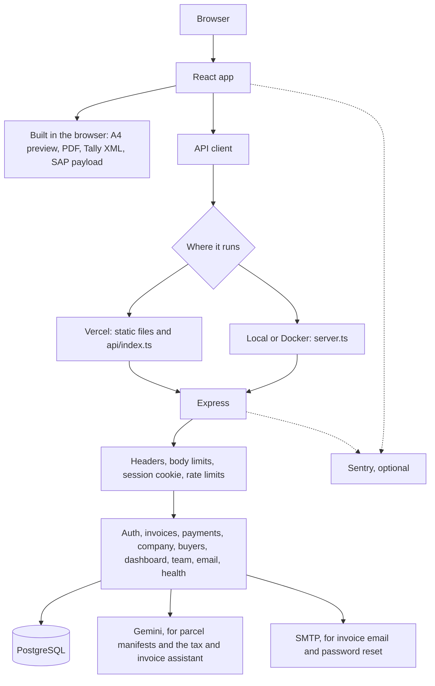
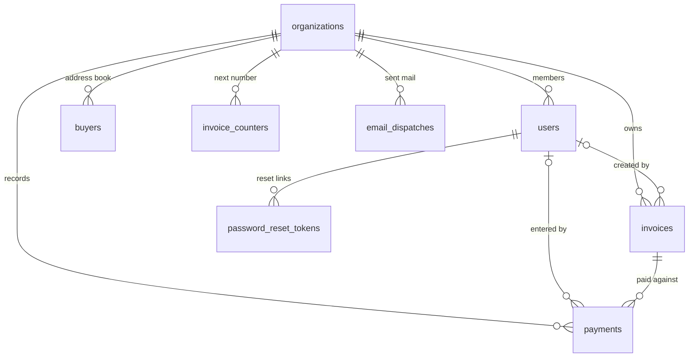

# DiamondX-A1005 Precision Engine

Web app for diamond export commercial invoices. Enter shipment data, preview an A4 invoice, export a PDF, and send the same invoice to Tally, SAP, or email.

The default sample exporter is **xyz LLC**.

## Architecture

The browser runs a React app. Signed-in screens call one Express API, which stores everything for a company in PostgreSQL. PDF, Tally, and SAP files are built in the browser. Parcel parsing and email are done on the server.



On Vercel, `vercel.json` sends every `/api` request to the single function `api/index.ts`. That function starts the same Express app used locally. In development, `server.ts` also serves the Vite app. In the Docker image it serves the built files from `dist` and runs the compiled server as the `node` user.

A request passes through security headers and a size limit, then the session cookie, then the rate limiter, then the route. Invoice bodies are checked with zod before they are saved. Unexpected server errors can be reported to Sentry when `SENTRY_DSN` is set. `GET /api/health` only checks that PostgreSQL answers.

```text
src/                  React UI
  api/client.ts       every call to /api
  components/         sign-in, workspace, and pages
  utils/              PDF, Tally, SAP, amount in words
server/               Express routes, migrations, email, monitoring
  app.ts              middleware and route registration
  vercelHandler.ts    adapter used by the Vercel function
api/index.ts          Vercel serverless entry
server.ts             local and Docker entry
db/migrations/        numbered SQL, applied once and recorded
```

### Data model

One company is an `organizations` row. Its members, invoices, buyers, and payments all belong to that company. Invoice line items stay inside the invoice `data` JSON. The numbered columns (`status`, `total_usd`, `buyer_name`, and the rest) exist so the list, search, and dashboard do not have to read that JSON.



Sessions live in the `session` table. Rate-limit counters live in `rate_limits`. Applied SQL files are recorded in `schema_migrations`.

## Features

- Company accounts: invoices, buyers, and settings are shared by everyone in a company
- Team members with two roles. Admins manage the company profile, team, deletions, and cancellations. Members create and issue invoices.
- Company profile that fills exporter, bank, and signatory details on every new invoice
- Buyer address book, with a picker in the workspace
- Automatic invoice numbers per Indian financial year, such as `EXP/2026-27/0001`, with your own prefix
- Invoice status: Draft, Issued, Paid, Cancelled. Issued invoices are locked; use Duplicate to start a new draft from one.
- Payment tracking per invoice. An invoice becomes Paid once payments cover its total.
- Dashboard with this month's exports, carats, exports by destination, and unpaid balances
- Invoice search by number, buyer, status, and date, with export to CSV for Excel
- Change password, and forgot-password reset by email
- Invoice workspace with live A4 preview
- PDF export
- AI parcel manifest parsing (Gemini)
- Tax and invoice assistant (Gemini). It answers from the company's own invoices, payments, and tax desk (deadlines, GSTR-1 filing check, export register, FEMA realization, forex, unmatched bank credits) through read-only tools. Every amount in a reply is checked against the data it looked up; an answer with an amount that is not there is flagged. It can propose a payment, a reminder draft, a bank-line match the matcher already suggests, or, for a chartered accountant, closing a month whose filing check is clean. Nothing changes until the user confirms, and confirming checks the books again first.
- Month review. For a chosen month, the assistant gathers the filing check, export register, realization, forex, and bank lines, proposes strong bank matches and a month close where they are safe, and summarises the result. The proposals come from code, not the model; if the model's summary is unavailable or mentions an amount that is not in the findings, a summary written from the findings is shown instead.
- Tally Prime XML and SAP payload generation
- SMTP email dispatch

## Requirements

- Node.js 22
- Docker, for PostgreSQL
- A [Gemini API key](https://aistudio.google.com/apikey) if you use the AI parcel parser

## Run locally

Start the database, then the app:

```bash
docker compose up postgres -d
npm install
cp .env.example .env
npm run dev
```

Open [http://localhost:3000](http://localhost:3000). Create an account on the sign-in page, then save invoices from the workspace.

Set `GEMINI_API_KEY` in `.env` before using the AI parcel parser. Set `DATABASE_URL` and `SESSION_SECRET` before the API starts. SMTP settings for invoice email are entered in the app when you send it.

Password reset emails use `SMTP_HOST`, `SMTP_PORT`, `SMTP_USER`, `SMTP_PASS`, and `SMTP_FROM`. Without them, the reset link is printed to the server log instead. Set `APP_URL` to your public site address so reset links point to it.

The demo account `owner@example.com` / `password123` is created in development and shown on the sign-in page.

## Database migrations

Schema changes live in `db/migrations` as numbered SQL files (`001_initial.sql`, `002_...`). Each file runs once, inside a transaction, and is recorded in the `schema_migrations` table. A lock stops two servers from migrating at the same time.

Pending migrations run when the app starts. To run them yourself instead, for example as a release step, set `MIGRATE_ON_START=false` and run:

```bash
npm run migrate
```

To change the schema, add a new file with the next number. Do not edit a file that has already run; the app logs a warning if one changes.

Databases created before migrations existed upgrade in place: the first three files only create what is missing. Each existing account becomes the admin of its own company, and its invoices move to that company as drafts.

## Production

| Variable | Purpose |
| --- | --- |
| `DATABASE_URL` | PostgreSQL connection string |
| `SESSION_SECRET` | Long random string that signs session cookies |
| `APP_URL` | Public site address, used in password reset links |
| `SMTP_HOST`, `SMTP_PORT`, `SMTP_USER`, `SMTP_PASS`, `SMTP_FROM` | Mail server for password reset emails |
| `SENTRY_DSN` | Optional. Reports server errors to Sentry |
| `VITE_SENTRY_DSN` | Optional. Reports browser errors to Sentry. Read at build time |
| `SEED_DEMO_USER` | Optional. `true` creates the demo account in production |
| `VITE_SHOW_DEMO_LOGIN` | Optional. `true` shows the demo credentials on the sign-in page. Read at build time |
| `MIGRATE_ON_START` | Optional. `false` skips migrations on startup |

In production the demo account is not created. If a database already has it with the public password, that password is replaced so nobody can sign in with it; the account and its invoices are kept. To run a public demo, set both `SEED_DEMO_USER=true` and `VITE_SHOW_DEMO_LOGIN=true`.

### Security

- Sign-in, sign-up, password reset, and email requests are rate-limited per IP address or per user. Counters are stored in PostgreSQL, so the limits hold across serverless instances. Too many requests get HTTP 429.

  | Request | Limit |
  | --- | --- |
  | Sign in | 10 failed attempts per 15 minutes per IP and email |
  | Create account | 5 per hour per IP |
  | Forgot password | 5 per hour per IP |
  | Reset password | 10 per hour per IP |
  | Send invoice email | 30 per hour per user |
  | Test SMTP settings | 20 per hour per user |
  | AI manifest parsing | 60 per hour per user |
  | Assistant question | 30 per hour per user |
  | Assistant month review | 10 per hour per user |

- Invoice email goes to at most 10 addresses, including CC, with up to 2 PDF attachments of 10 MB each. SMTP servers must present a valid TLS certificate unless the sender ticks "Allow invalid certificates". Every send is logged in the `email_dispatches` table.
- Request bodies are limited to 1 MB, except manifest parsing (15 MB) and invoice email (25 MB). Vercel caps every request at 4.5 MB.
- Responses carry a Content Security Policy, HSTS, and anti-framing headers. The same policy is set for static files in `vercel.json`; a test keeps the two in sync.
- Saved invoices are checked field by field. Each line total must equal carats × rate, and the currency must be USD.

### Monitoring

`GET /api/health` returns `200 {"status":"ok"}` when the database answers, and `503` when it does not. Point an uptime monitor at it. The Docker image uses it as its health check.

Set `SENTRY_DSN` and `VITE_SENTRY_DSN` to send errors to [Sentry](https://sentry.io). Server reports include the request method, path, user ID, and company ID. Request bodies, cookies, and headers are not sent, because they can contain passwords.

### Backups

Use a host with point-in-time recovery. On [Neon](https://neon.tech), restore history is on by default; check its length under **Settings → Storage** (the free plan keeps 24 hours, paid plans up to 30 days). To recover, create a branch from a point before the problem in the Neon console, check the data, then point `DATABASE_URL` at it or restore the main branch from it.

For a copy you hold yourself, run `pg_dump "$DATABASE_URL" -Fc -f diamondx-$(date +%F).dump` on a schedule and store the files outside Neon.

## Vercel

The site is a static frontend plus a serverless API. In the Vercel project settings, set:

- `DATABASE_URL` to a hosted Postgres connection string. The database inside Docker is not reachable from Vercel.
- `SESSION_SECRET` to a long random string.
- Optional: the other variables in [Production](#production).

All `/api` requests go to one serverless function, `api/index.ts`, through the rewrite in `vercel.json`.

Redeploy after saving those variables. The sign-in page opens even if the database is missing. Pending migrations run the first time each new deployment connects to the database.

## Docker

```bash
docker compose up --build
```

PostgreSQL and the app start together. The app listens on port 3000. Pass `GEMINI_API_KEY` in the environment if you want AI parsing inside the container. Override `SESSION_SECRET` for anything other than a local demo. The container runs in production mode, so create an account on the sign-in page, or start it with `SEED_DEMO_USER=true docker compose up --build` for the demo account.

The image compiles the server to plain JavaScript, installs only production packages, and runs as the unprivileged `node` user.

## Tests

```bash
npm test
```

The suite starts a temporary PostgreSQL database, then checks:
- accounts, roles, and password reset
- saved invoices, numbering, payments, and search
- rate limits, email safety, security headers, and migrations
- Tally XML, SAP payloads, and amounts in words
- the login form

Docker is only needed when you run the app. To use a database you already have, set `TEST_DATABASE_URL`; the tests wipe its tables.

## Continuous integration

GitHub Actions runs `.github/workflows/ci.yml` on every push to `main` and every pull request. It type-checks the code, runs the tests against a PostgreSQL service container, and builds the frontend.

## Scripts

| Command | Purpose |
| --- | --- |
| `npm run dev` | Start the app with live reload |
| `npm run build` | Build the frontend |
| `npm run build:server` | Compile the server to `dist-server` |
| `npm start` | Start the compiled server. Run both builds first, with `NODE_ENV=production` |
| `npm run migrate` | Apply pending database migrations |
| `npm run lint` | Type-check the project |
| `npm test` | Run all tests |
