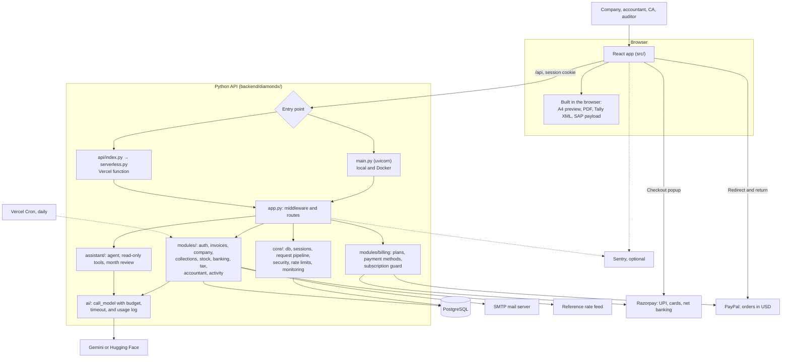
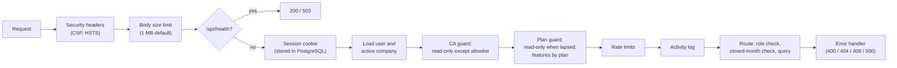
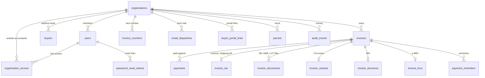
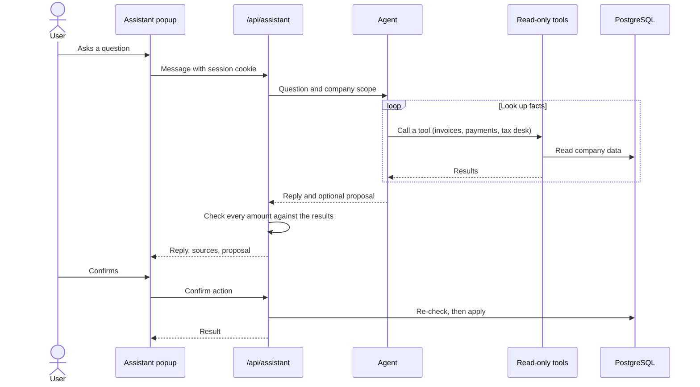
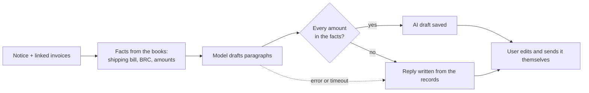
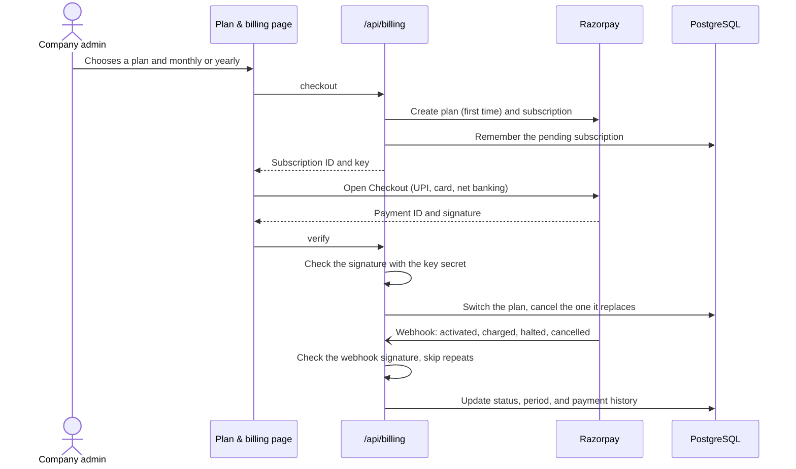

# DiamondX-A1005 Precision Engine

Export invoicing and tax compliance for Indian diamond exporters, in one web app shared by the company, its accountant, its chartered accountant (CA), and its tax auditor.

- **The company** makes A4 export invoices, tracks payments and stock, and chases buyers.
- **The accountant** matches the bank, GSTR-2B, and Tally against the books, and records TDS on payments abroad.
- **The CA** reviews invoices, closes months, raises document requests, answers notices, and runs a practice across clients.
- **The tax auditor** gets automatic audit checks and a Form 3CD pack built from the books.

The default sample exporter is **xyz LLC**.

---

## Contents

1. [Features](#features)
2. [Architecture](#architecture)
3. [Project structure](#project-structure)
4. [Roles and permissions](#roles-and-permissions)
5. [Data model](#data-model)
6. [AI](#ai)
7. [Run locally](#run-locally)
8. [Configuration](#configuration)
9. [Database migrations](#database-migrations)
10. [Deploy](#deploy)
11. [Security](#security)
12. [Monitoring and backups](#monitoring-and-backups)
13. [Tests and CI](#tests-and-ci)
14. [Plans and pricing](#plans-and-pricing)
15. [Adding a feature](#adding-a-feature)
16. [Scripts](#scripts)

---

## Features

### Invoicing

| Feature | What it does |
| --- | --- |
| Invoice editor | Six sections (parties, shipment, goods, packing, bank, compliance) beside a live A4 preview. Every field the invoice prints can be edited; a saved buyer fills the consignee |
| Checks before issuing | IEC, GSTIN, PAN, AD code, SWIFT, and IFSC formats; PAN and state code against the GSTIN; KP certificate for rough; LUT ARN with the LUT clause; 8-digit HS codes; certificates for single stones and used twice. Errors block issuing and are marked on the field; warnings are listed when you issue |
| Working safely | One toolbar (open, new, duplicate, save, issue, PDF); unsaved-changes marker and a warning before leaving; ⌘S / Ctrl+S saves; issued invoices are locked, and Duplicate starts a new draft |
| Numbering | Automatic per Indian financial year, such as `EXP/2026-27/0001`, with your own prefix |
| Status | Draft → Issued → Paid, or Cancelled. Issued invoices are locked |
| Accounts export | Tally Prime XML and SAP payload, built in the browser |
| Email | Send the invoice PDF by SMTP; every send is logged |
| AI manifest parsing | Read a parcel manifest (image or text) into invoice lines |
| Buyers | Address book, buyer portal links, payment record grade (A–D), and credit limits. Issuing an invoice warns when the buyer is overdue, slow, or over the limit |
| Collections | Overdue list and payment reminder emails drafted by AI, with a written fallback |
| Dashboard | This month's exports, carats, destinations, unpaid balances, and a cash-flow forecast |

### Diamonds and stock

| Feature | What it does |
| --- | --- |
| Parcels | Rough and polished parcels with cost. A polished parcel records the rough parcel it was cut from |
| Stock register | Opening, received, sent for cutting, sold, and closing carats per year, with yield, process loss, and closing value at cost (Form 3CD clause 35) |
| Certificate check | Grading certificates on invoices: certified stones, certificates used twice, one certificate for several stones |
| Kimberley Process register | KP certificate, HS codes, and rough carats per export |

### Tax desk

Fifteen desks in five groups, chosen from a side menu. Desks not on the company's plan show a lock and what unlocks them.

| Group | Desk | What it does |
| --- | --- | --- |
| Overview | Due dates | GSTR-1, GSTR-3B, LUT, realization, and refund deadlines |
| GST | GSTR-1 filing check | Table 6A and e-invoice readiness for each issued invoice |
| | Export register | Month register with shipping bills and the CA's review; GST pack download |
| | Purchases & ITC | Purchase register (imports by Bill of Entry, local purchases by GST invoice). Import GSTR-2B and see credit matched, at risk, and not claimed |
| | GST refund | Refund statement for zero-rated exports under LUT |
| Bank & forex | Bank match | Import a statement (CSV, or PDF/image read by AI) and match credits to invoices |
| | Tally match | Import a Tally Day Book (XML or CSV) and compare sales, receipts, and purchases with the app |
| | FEMA realization | Realization deadline per export, and e-BRC import |
| | Exchange gain / loss | Invoice rate vs bank rate per receipt, exported to Tally |
| | Exchange rates | Daily reference rates, plus your own rates |
| Income tax & audit | Payments abroad / TDS | Brokerage, freight, and fees paid outside India: TDS, treaty rate, and the Form 15CA part (A, C, or D) with 15CB when needed |
| | Audit checks | Gaps in invoice numbers, edits after a closed month was reopened, unusual rates per carat, unmatched payments, round amounts, Sunday invoices, missing shipping bills, foreign payments without TDS or 15CA |
| | Tax audit (3CD) | Turnover, clauses 23, 34, 35, and 44, exchange differences, and receivables past the realization period, with one zip download |
| Notices & sign-off | Notices | GST, Income Tax, Customs, DGFT, and RBI notices with reply deadlines, linked invoices, and a reply drafted from your own records |
| | Closed months | The CA signs off a month; nothing dated in it can change until it is reopened. Financial year pack download |

### Working with the accountant

| Feature | What it does |
| --- | --- |
| Outside accountants | A company invites a CA or tax firm; the firm switches between its client companies |
| Requests | The CA asks for a document or answer; the company replies with a message or file. Open, answered, or closed, with a due date |
| Practice | For a firm with clients: health score per client, time logged, fees, and fee bills |
| Activity | Every change, with who made it and when; CSV download |
| Assistant | Answers questions from the company's own data and proposes actions; see [AI](#ai) |

## Architecture

The browser runs a React app. Every signed-in screen calls one Python API (FastAPI), which keeps all data for a company in PostgreSQL. PDF, Tally XML, and SAP files are built in the browser. AI calls, email, and file imports run on the server.



### How a request is handled

Every `/api` request passes the same steps, in this order. A route only runs once the user is known, allowed, and within limits.



- **Company scope.** Every query filters by the signed-in user's active company.
- **Closed months.** Changes to invoices, payments, purchases, and payments abroad dated in a closed month are refused with `409`.
- **Two entry points, one app.** On Vercel, `vercel.json` sends every `/api` request to `api/index.py`, which builds the same FastAPI app once per instance (`serverless.py`). Locally, `npm run dev` runs the API and the Vite dev server side by side; in Docker the API also serves the built files from `dist/`.

---

## Project structure

Code is grouped by feature. Each API module owns its routes, SQL, and rules; each frontend feature owns its pages. Shared pieces live in `core/` (API) and `components/` (browser).

```text
.
├── api/
│   └── index.py                 Vercel serverless entry
├── db/
│   ├── init/                    Creates the test database in Docker
│   └── migrations/              Numbered SQL, applied once, in order
│
├── backend/                     Python API (FastAPI), package diamondx
│   ├── pyproject.toml, uv.lock  Dependencies (uv)
│   ├── diamondx/
│   │   ├── main.py              Local and Docker entry: env, migrate, seed, serve
│   │   ├── app.py               Middleware order and route registration
│   │   ├── serverless.py        Adapter used by api/index.py
│   │   │
│   │   ├── core/                Shared by every module
│   │   │   ├── db.py            Pool, migrations
│   │   │   ├── context.py       Request pipeline: session, user, CA and plan guards, rate limit, activity log
│   │   │   ├── sessions.py      Cookie sessions in PostgreSQL
│   │   │   ├── http.py          Roles, guards, current user, ApiError
│   │   │   ├── form_input.py    Request body readers, document-number matching, dates
│   │   │   ├── numbers.py       Rounding and formatting that match JavaScript
│   │   │   ├── security.py      Headers, CSP, body limits
│   │   │   ├── rate_limit.py    Limits stored in PostgreSQL
│   │   │   ├── monitoring.py    Sentry
│   │   │   ├── health.py        /api/health
│   │   │   ├── mailer.py        Password reset mail
│   │   │   ├── migrate.py       npm run migrate
│   │   │   └── seed.py, demo_data.py  Demo account and sample data
│   │   │
│   │   ├── modules/             One folder per business area
│   │   │   ├── auth/            Sign in, password reset, team members
│   │   │   ├── company/         Company profile, buyers, buyer credit risk
│   │   │   ├── invoices/        Invoices (schema.py), payments, dashboard, buyer portal, manifest reading
│   │   │   ├── collections/     Overdue reminders, invoice email
│   │   │   ├── stock/           Parcels, stock register
│   │   │   ├── banking/         Bank statements, AI statement reader, Tally sync
│   │   │   ├── tax/             Filing, register, purchases & ITC, realization,
│   │   │   │                    forex, rates, refunds, TDS, audit checks,
│   │   │   │                    3CD pack, notices, closed months
│   │   │   ├── accountant/      Multi-company workspace, requests, practice
│   │   │   ├── billing/         Plans, Razorpay, bank transfer, PayPal, subscription guard
│   │   │   └── activity/        Activity log
│   │   │
│   │   ├── assistant/           Tool-calling agent, read-only tools, month review, grounding check
│   │   └── ai/                  Provider choice and call_model (budget, timeout, log)
│   └── tests/                   API tests (pytest) against a temporary PostgreSQL
│
├── src/                         React app
│   ├── main.tsx, App.tsx        Start-up, sign-in, navigation shell
│   ├── api/client.ts            Every call to /api, and response types
│   ├── components/              Shared UI: buttons, cards, tables, form fields
│   ├── features/                One folder per area, matching the server
│   │   ├── invoices/editor/     Invoice editor: sections, line items, toolbar, checks
│   │   ├── auth/  company/  buyers/  invoices/  collections/
│   │   ├── dashboard/  diamonds/  tax/  accountant/  assistant/  billing/
│   ├── utils/                   PDF, Tally XML, SAP, amount in words
│   ├── types/, data/            Invoice types and sample invoices (sampleInvoices.json, shared with the API)
│   └── monitoring.ts            Browser Sentry
│
├── requirements.txt             Python packages for Vercel and Docker (from backend/pyproject.toml)
├── Dockerfile, docker-compose.yml
├── vercel.json                  Rewrites, headers, cron, function settings
└── vite.config.ts, vitest.config.ts, tsconfig.json
```

### Where each area lives

| Area | API module (`backend/diamondx/`) | Screens | Main routes |
| --- | --- | --- | --- |
| Accounts and team | `modules/auth/` | `features/auth`, `features/company` | `/api/auth/*`, `/api/team/*` |
| Company and buyers | `modules/company/` | `features/company`, `features/buyers` | `/api/company`, `/api/buyers/*` |
| Invoices and payments | `modules/invoices/` | `features/invoices`, `features/dashboard` | `/api/invoices/*`, `/api/dashboard`, `/api/portal/*` |
| Collections | `modules/collections/` | `features/collections` | `/api/reminders/*`, `/api/send-email` |
| Stock | `modules/stock/` | `features/diamonds` | `/api/parcels/*`, `/api/stock/*` |
| Banking and Tally | `modules/banking/` | `features/tax` | `/api/bank/*`, `/api/tally/*` |
| Tax desk | `modules/tax/` | `features/tax` | `/api/tax/*`, `/api/purchases/*`, `/api/foreign-payments/*`, `/api/notices/*`, `/api/rates/*` |
| Accountant | `modules/accountant/` | `features/accountant` | `/api/workspace/*`, `/api/requests/*`, `/api/practice/*` |
| Activity | `modules/activity/` | `features/company` | `/api/audit` |
| Plan & billing | `modules/billing/` | `features/billing` | `/api/billing/*` |
| Assistant | `assistant/` | `features/assistant` | `/api/assistant/*` |

## Data model

Every row belongs to one company (`organizations`). Invoice line items stay inside the invoice `data` JSON; the plain columns (`status`, `total_usd`, `buyer_name`, …) exist so lists, search, and the dashboard do not have to read the JSON.

### Invoicing and company



### Tax, banking, and the accountant

```mermaid
erDiagram
  organizations ||--o{ purchases : "imports and local buys"
  organizations ||--o{ gstr2b_lines : "GSTR-2B by month"
  organizations ||--o{ bank_lines : "bank credits"
  bank_lines }o--o| payments : "matched to"
  organizations ||--o{ tally_vouchers : "Tally day book"
  organizations ||--o{ foreign_payments : "payments abroad, TDS"
  organizations ||--o{ tax_notices : "notices"
  organizations ||--o{ closed_months : "signed off"
  organizations ||--o| organization_tax_settings : "LUT, realization period"
  organizations ||--o{ organization_rates : "own rates"
  organizations ||--o{ client_requests : "requests"
  client_requests ||--o{ client_request_messages : "replies and files"
  organizations ||--o{ ca_engagements : "firm to client fee"
  organizations ||--o{ ca_time_entries : "time logged"
  organizations ||--o{ ca_fee_bills : "fee bills"
  organizations ||--o| organization_subscriptions : "plan"
  organizations ||--o{ subscription_payments : "plan payments"
  organizations ||--o{ ai_calls : "AI usage"
  organizations ||--o{ assistant_sessions : "chats"
  assistant_sessions ||--o{ assistant_messages : "messages"
  assistant_sessions ||--o{ assistant_actions : "proposals"
```



`reference_rates` holds daily exchange rates for everyone; `razorpay_plans` caches the Razorpay plan IDs and `billing_events` records webhooks already handled. Sessions live in `session`, rate-limit counters in `rate_limits`, and applied migrations in `schema_migrations`.

---

## AI

All AI features use one provider, chosen by `AI_PROVIDER`. Every call goes through `call_model` in `backend/diamondx/ai/call.py`, which checks AI is on, enforces a daily token budget per company, times out slow calls, retries once, and logs each call to `ai_calls`.

| Feature | Model's job | When the model fails or is unsure |
| --- | --- | --- |
| Assistant | Answer from read-only tools; propose an action | Amounts not found in the looked-up data are flagged |
| Month review | Summarise findings that code produced | A summary written from the findings |
| Payment reminder | Write the wording | A written template |
| Notice reply | Draft a reply from the notice and linked invoices | A reply written from the records |
| Manifest and statement reading | Read lines from a file | The user checks the lines before saving |

### Assistant flow

The assistant opens as a popup after sign-in. The model can only read and propose; nothing changes until the user confirms, and confirming checks the books again first.



### Notice reply flow



### Choosing the model

| `AI_PROVIDER` | Needs | Model |
| --- | --- | --- |
| `gemini` (default) | `GEMINI_API_KEY` | Gemini |
| `huggingface` | `HF_TOKEN` | `HF_MODEL`, default `meta-llama/Llama-3.3-70B-Instruct` |

For Hugging Face, create a token at https://huggingface.co/settings/tokens with "Make calls to Inference Providers", and pick a chat model that supports tool calling. Reading manifest images needs Gemini; with Hugging Face, paste the text. Restart the API after changing `.env`. Gemini is called over its REST API with httpx; there is no SDK to install.

---

## Run locally

Requirements: Node.js 22 (for the frontend), [uv](https://docs.astral.sh/uv/) (installs Python 3.12 and the API's packages), and Docker (for PostgreSQL).

```bash
docker compose up postgres -d
npm install
cp .env.example .env
npm run dev
```

`npm run dev` starts the API on port 8000 and Vite on port 3000, which sends `/api` to the API. Open [http://localhost:3000](http://localhost:3000) and sign in with the demo account `owner@example.com` / `password123`, or create an account. In development the API documentation is at [http://localhost:8000/api/docs](http://localhost:8000/api/docs).

- Set `GEMINI_API_KEY` (or the Hugging Face variables) before using AI features.
- Without SMTP settings, password reset links are printed to the API log.

---

## Configuration

| Variable | Required | Purpose |
| --- | :---: | --- |
| `DATABASE_URL` | ✓ | PostgreSQL connection string |
| `SESSION_SECRET` | ✓ | Long random string that signs session cookies |
| `APP_URL` | | Public site address, used in password reset and portal links |
| `AI_PROVIDER` | | `gemini` (default) or `huggingface` |
| `GEMINI_API_KEY` | | Gemini key |
| `HF_TOKEN`, `HF_MODEL` | | Hugging Face token and model |
| `AI_ENABLED` | | `false` turns every AI feature off |
| `AI_DAILY_TOKEN_BUDGET` | | Tokens per company per day, default 2,000,000 |
| `AI_TIMEOUT_MS` | | Per-call timeout, default 20000 |
| `SMTP_HOST`, `SMTP_PORT`, `SMTP_USER`, `SMTP_PASS`, `SMTP_FROM` | | Mail server for password reset |
| `CRON_SECRET` | | Bearer token Vercel Cron sends to `/api/cron/rates` |
| `RAZORPAY_KEY_ID`, `RAZORPAY_KEY_SECRET` | | Razorpay API keys. Without them plans are shown but checkout is off |
| `RAZORPAY_WEBHOOK_SECRET` | | Secret of the Razorpay webhook pointed at `/api/billing/webhook` |
| `BILLING_BANK_ACCOUNT_NAME`, `BILLING_BANK_NAME`, `BILLING_BANK_ACCOUNT_NUMBER`, `BILLING_BANK_IFSC`, `BILLING_BANK_BRANCH`, `BILLING_BANK_ACCOUNT_TYPE`, `BILLING_GSTIN` | | The account plan payments by bank transfer go to. On when the number and IFSC are set |
| `PLATFORM_ADMIN_EMAILS` | | Comma-separated emails of the people who approve bank transfers |
| `PAYPAL_CLIENT_ID`, `PAYPAL_CLIENT_SECRET`, `PAYPAL_ENV` | | PayPal for companies outside India; `PAYPAL_ENV` is `sandbox` (default) or `live` |
| `APP_ENV` | | `production` turns on CSP and HSTS, hides `/api/docs`, and serves `dist/`. `NODE_ENV` is read if it is not set |
| `PORT` | | Port the API listens on, default 3000 (`npm run dev` uses 8000) |
| `MIGRATE_ON_START` | | `false` skips migrations at start-up |
| `SEED_DEMO_USER` | | `true` creates the demo account in production |
| `VITE_SHOW_DEMO_LOGIN` | | `true` shows demo credentials on the sign-in page. Build time |
| `SENTRY_DSN`, `VITE_SENTRY_DSN` | | Server and browser error reporting. The browser one is read at build time |
| `TEST_DATABASE_URL` | | Use an existing database for tests. **Its tables are wiped** |

In production the demo account is not created, and if one exists with the public password, that password is replaced.

---

## Database migrations

Schema changes live in `db/migrations` as numbered SQL files. Each file runs once inside a transaction and is recorded with a checksum in `schema_migrations`. An advisory lock stops two servers from migrating at once, and the files stay safe to run through a connection pooler (Neon, pgbouncer).

| File | Adds |
| --- | --- |
| `001`–`003` | Users, invoices, sessions, companies, buyers, payments, email log, rate limits |
| `004` | Payment reminders and credit days |
| `005` | AI calls and assistant sessions |
| `006` | Invoice tax details, documents, CA reviews, closed months |
| `007` | E-invoices, bank lines, e-BRCs, tax settings, outside accountant access |
| `008` | Assistant tax actions |
| `009` | Exchange rates, activity log, parcels, buyer portal |
| `010` | Purchases and GSTR-2B, stock kinds, requests, notices, payments abroad, Tally vouchers, practice, buyer credit limits |
| `011` | Subscriptions, Razorpay plans, plan payments, webhook events, and when each invoice was issued |
| `012` | Payment method per plan, bank transfer requests, PayPal orders, and payment currency |

Pending migrations run at start-up. To run them as a release step instead, set `MIGRATE_ON_START=false` and run `npm run migrate`.

To change the schema, add the next number. **Never edit a file that has already run**; the app warns if one changes.

---

## Deploy

### Vercel

The site is a static frontend plus one serverless function.

1. In the project settings, set `DATABASE_URL` (a hosted Postgres; the Docker one is not reachable), `SESSION_SECRET`, and `CRON_SECRET`.
2. Add any other variables from [Configuration](#configuration).
3. Redeploy. Pending migrations run the first time a new deployment connects.

`vercel.json` rewrites `/api/*` to the Python function `api/index.py` (packages from `requirements.txt`), ships `db/**`, the API code, and the sample invoices with it, sets the security headers for static files, and calls `/api/cron/rates` daily.

### Docker

```bash
docker compose up --build
```

PostgreSQL and the app start together on port 3000. The image builds the frontend with Node, then runs the Python API (which also serves `dist/`) on `python:3.12-slim` as an unprivileged user, with `/api/health` as its health check. Set `SESSION_SECRET` for anything beyond a local demo, and `SEED_DEMO_USER=true` for the demo account.

---

## Security

- **Sessions** are stored in PostgreSQL; cookies are signed with `SESSION_SECRET`.
- **Headers:** Content Security Policy, HSTS, and anti-framing. The same CSP is in `backend/diamondx/core/security.py` and `vercel.json`; a test keeps them in sync.
- **Validation:** invoices are checked with Pydantic plus business rules (line total = carats × rate, USD only) in `modules/invoices/schema.py`. Other forms use `core/form_input.py`.
- **Uploads:** request files accept PDF, images, CSV, and Excel up to 2 MB; downloads are sent as attachments with `nosniff`.
- **Email:** at most 10 recipients and 2 PDF attachments of 10 MB each. SMTP must present a valid certificate unless the sender allows otherwise.

### Body size limits

| Route | Limit |
| --- | --- |
| Default | 1 MB |
| Manifest parsing, statement reading | 15 MB |
| Invoice email | 25 MB |
| Tally import | 4 MB |
| Invoice documents, bank and e-BRC import, statement lines, GSTR-2B, request replies | 3 MB |

Vercel caps every request at 4.5 MB.

### Rate limits

Counters are stored in PostgreSQL, so limits hold across serverless instances. Too many requests get HTTP 429.

| Request | Limit |
| --- | --- |
| Sign in | 10 failed attempts per 15 minutes per IP and email |
| Create account | 5 per hour per IP |
| Forgot password / reset password | 5 / 10 per hour per IP |
| Send invoice email / test SMTP | 30 / 20 per hour per user |
| AI manifest parsing / statement reading | 60 / 30 per hour per user |
| Reminder draft / reminder send | 60 / 30 per hour per user |
| Notice reply draft | 30 per hour per user |
| Tally import | 30 per hour per user |
| Assistant question / month review | 30 / 10 per hour per user |
| Buyer portal | 120 per 15 minutes per IP |
| Plan checkout / PayPal order / bank transfer request | 20 / 20 / 10 per hour per user |

---

## Monitoring and backups

- `GET /api/health` returns `200 {"status":"ok"}` when the database answers and `503` when it does not. Point an uptime monitor at it.
- Set `SENTRY_DSN` and `VITE_SENTRY_DSN` to send errors to [Sentry](https://sentry.io). Reports include method, path, user ID, and company ID, never bodies, cookies, or headers.
- Use a host with point-in-time recovery. On [Neon](https://neon.tech), check the restore window under **Settings → Storage**; to recover, branch from a point before the problem, check it, then point `DATABASE_URL` at it.
- For your own copy, run `pg_dump "$DATABASE_URL" -Fc -f diamondx-$(date +%F).dump` on a schedule and store it outside the host.

---

## Tests and CI

```bash
npm run test:api                                        # API tests (pytest)
cd backend && uv run pytest tests/test_tax.py            # one file
cd backend && uv run pytest -k "stock_register"          # tests whose name matches
npm test                                                 # frontend tests (vitest)
```

API tests start a temporary PostgreSQL (the `embedded-postgres` binaries from `npm install`, or any folder of PostgreSQL binaries in `PG_BIN`) unless `TEST_DATABASE_URL` is set, and drive the real app with httpx. Outside services are fakes passed in through `AppOptions`: mail, the AI model and drafters, Razorpay, PayPal, and the rate feed. They cover:

- accounts, roles, the CA guard, sessions, and password reset
- invoices, numbering, payments, search, and closed months
- the tax desk: filing, register, realization, forex, bank matching
- purchases and GSTR-2B, stock register, payments abroad, audit checks, 3CD pack, Tally reconciliation, requests, notices, practice, and buyer risk
- plans, Razorpay checkout and webhooks, bank transfer, and PayPal
- the assistant and month review, with a scripted model; real-model evals run with `RUN_AI_EVALS=1`
- rate limits, email safety, security headers, migrations, and the Vercel entry
- in the browser code: Tally XML, SAP payloads, amounts in words, and the login form

GitHub Actions (`.github/workflows/ci.yml`) runs two jobs on every push to `main` and every pull request: the frontend type check, tests, and build; and the API tests against a PostgreSQL 16 service

### Ways to pay

| Method | Through | Renews | Turn it on with |
| --- | --- | --- | --- |
| UPI | Razorpay UPI AutoPay | Automatically | Razorpay keys |
| Debit or credit card | Razorpay (recurring card) | Automatically | Razorpay keys |
| Net banking | Razorpay e-mandate | Automatically | Razorpay keys |
| Bank transfer (NEFT / RTGS / IMPS) | Your bank account | One period at a time | `BILLING_BANK_*` and `PLATFORM_ADMIN_EMAILS` |
| PayPal (outside India, USD) | PayPal Orders | One period at a time | `PAYPAL_CLIENT_ID`, `PAYPAL_CLIENT_SECRET` |

Card numbers, UPI PINs, and bank passwords are entered on Razorpay's or PayPal's own page and never reach this server, so the app stays out of PCI DSS scope. Only payment IDs, amounts, and the bank transfer UTR are stored.

- **Bank transfer:** the admin chooses a plan and gets your account details, the amount with GST, and a reference code (`DX-XXXXXX`) for the remarks. After paying, they enter the UTR. A site operator (an email in `PLATFORM_ADMIN_EMAILS`) sees it on **Bank transfers**, checks the credit in the bank statement, and approves it, which switches the plan on for one period, or rejects it with a reason the company sees. A UTR can only be used once.
- **PayPal:** the admin is sent to PayPal to pay in US dollars and comes back to the billing page, which captures the payment. The plan starts only if PayPal confirms the full amount. Create the app at developer.paypal.com; use `PAYPAL_ENV=sandbox` and sandbox accounts to test. PayPal does not process payments between two Indian parties, so offer it to companies outside India.
- **Paying one period at a time:** paying again for the same plan before it ends adds a period after the current one. Switching to a one-period method stops any Razorpay renewal, so nobody is charged twice.

### Turning on Razorpay

1. Create a [Razorpay](https://razorpay.com) account, and under **Account & Settings → API keys** create test keys (`rzp_test_...`).
2. Set `RAZORPAY_KEY_ID` and `RAZORPAY_KEY_SECRET`.
3. Under **Webhooks**, add `https://<your site>/api/billing/webhook` with the `subscription.*` events (activated, charged, pending, halted, cancelled, completed, resumed), and set its secret as `RAZORPAY_WEBHOOK_SECRET`.
4. Pay for a plan with a [test card or UPI ID](https://razorpay.com/docs/payments/payments/test-card-details/), and check it on the Plan & billing page.
5. When Razorpay activates your live account, swap in the live keys and a live webhook.

Razorpay plans are created on first checkout for each plan, cycle, and price, so there is nothing to set up in the Razorpay dashboard. A price change creates a new Razorpay plan; existing subscribers stay on their old price until they change plan.



Not covered yet: emailing the operator when a bank transfer is waiting, GST tax invoices for the subscription itself (Razorpay sends a payment receipt; issue a GST invoice from your own books, or turn on Razorpay Invoices), coupons, and refunds, which are made from the Razorpay dashboard.

---

## Adding a feature

1. **Schema:** add `db/migrations/NNN_name.sql` with the next number.
2. **API:** add a file under the right `backend/diamondx/modules/<area>/` with a `build_router()` that creates its router with `api_router()` from `core/context.py`, and add the module to the list in `create_app` (`app.py`).
   - Filter every query by `user.organization_id`.
   - Guard routes with `Depends(require_user)`, `require_admin`, `require_roles(...)`, or the tax guards in `modules/tax/shared.py`.
   - Read bodies with `body(request)` or `form_reader(...)` from `core/form_input.py`; raise `ApiError(status, message)` for anything the user must fix.
   - Refuse changes dated in a closed month (`closed_month_message`).
   - If a CA must write to it, add the path to the allowlist in `core/context.py`.
   - Add a rule to `modules/activity/audit.py` so the change shows in Activity.
   - Route any AI call through `call_model`, and add its feature name to `Feature` in `ai/call.py`.
   - If it belongs to a paid tier, add its path to `feature_for_path` in `modules/billing/plans.py`.
   - Keep responses as the browser expects them: camelCase keys, `iso()` for timestamps, and the rounding helpers in `core/numbers.py` for money.
3. **Browser:** add response types to `src/api/client.ts`, a screen under `src/features/<area>/`, and a navigation entry in `App.tsx` or a desk in `TaxPage.tsx`.
4. **Tests:** add API tests under `backend/tests/`, and run `npm run lint && npm test && npm run test:api`.

---

## Scripts

| Command | Purpose |
| --- | --- |
| `npm run dev` | Start the API (port 8000) and Vite (port 3000) with live reload |
| `npm run dev:api` / `npm run dev:web` | Start only the API, or only Vite |
| `npm run build` | Build the frontend to `dist/` |
| `npm start` | Run the API in production mode, serving `dist/`. Build first |
| `npm run migrate` | Apply pending migrations |
| `npm run seed:demo` | Create the demo account. Add `-- --reset` to wipe and reload its sample data |
| `npm run lint` | Type-check the frontend |
| `npm test` | Run the frontend tests |
| `npm run test:api` | Run the API tests |
| `npm run clean` | Remove `dist/` |
